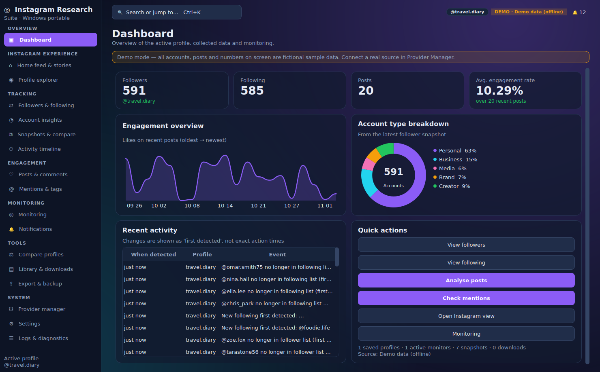
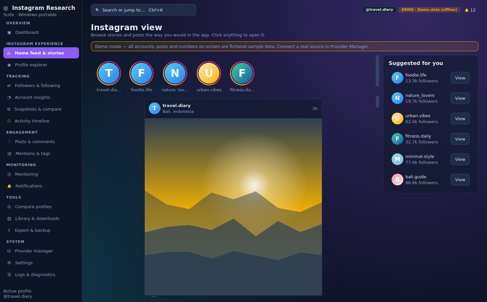
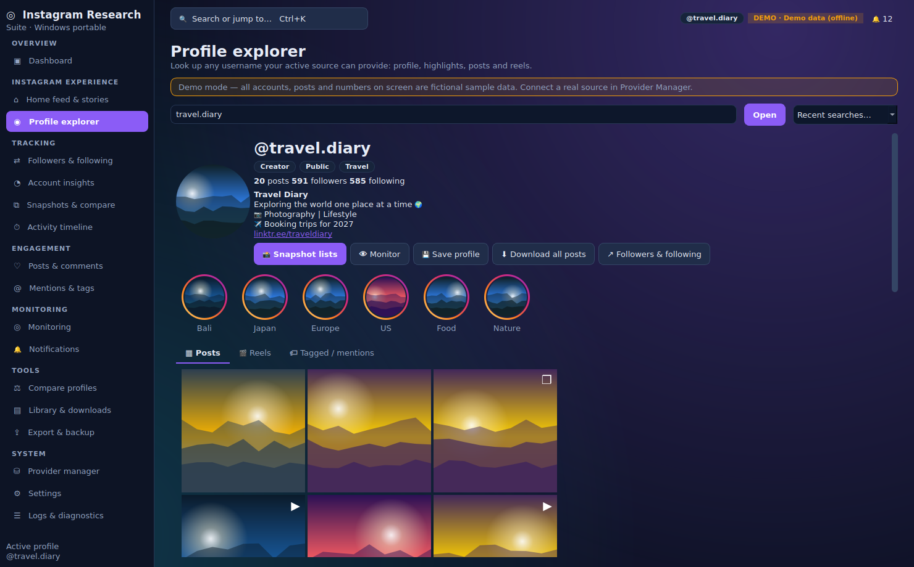
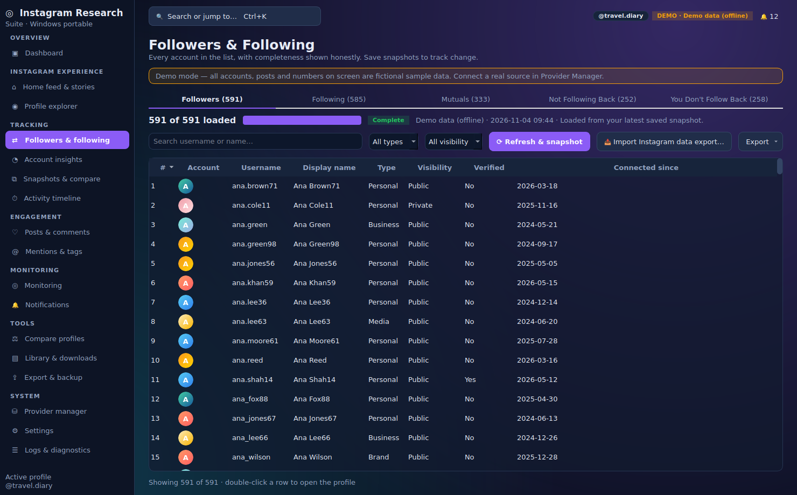
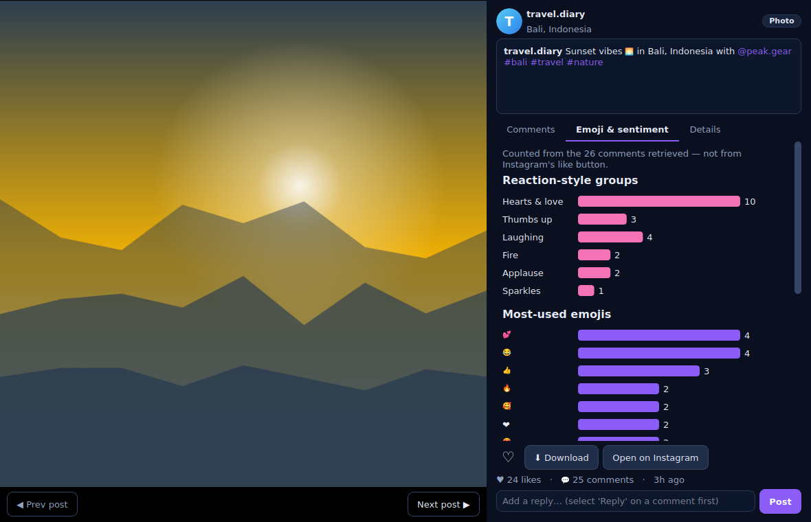
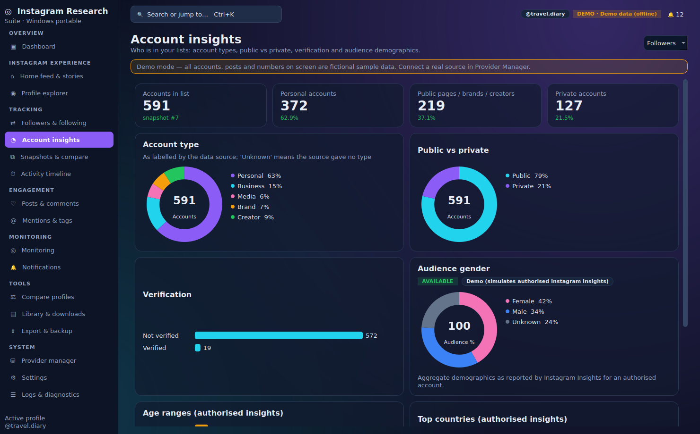
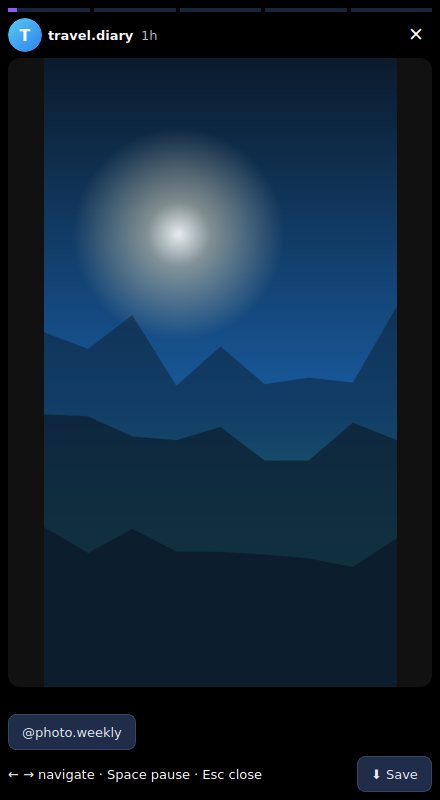

# Instagram Research Suite

A Windows **portable desktop app** (Python + PySide6 + SQLite) that gives you an Instagram-style viewer and a research dashboard for Instagram data **you are authorised to access**: complete follower/following lists with snapshots, account classification, post/comment/emoji analytics, mentions, monitoring and reports.



## Your requirements, and how each is delivered

| # | You asked for | What the app does |
|---|---|---|
| 1 | See **all** followers and following (587 of 587) and take snapshots | Full-list explorer with a live **"587 of 587 loaded"** completeness indicator, search/sort/filter, 5 relationship tabs (Followers, Following, Mutuals, Not following back, You don't follow back), saved snapshots, two-snapshot diff, CSV/Excel/PDF/HTML/JSON/Markdown export. Complete lists come from your own **Instagram data export** (see below). |
| 2 | How many girl/boy accounts and public pages | Account-type breakdown (personal / business / creator / brand / media), public vs private, verified. **Gender**: aggregate audience gender from Instagram Insights for accounts you own; otherwise *Unknown*. The app deliberately never guesses gender from names or photos. |
| 3 | Likes, comments, replies, heart/thumbs-up counts | Post viewer with comments **and nested replies**, reply box, per-post and all-post emoji analysis (hearts, thumbs-up, laughing, fire, applause…), sentiment indicator, top commenters, engagement rate. Emoji are counted from retrieved comment text; Instagram has no public per-reaction breakdown. |
| 4 | Who is mentioned in posts and stories | Mentions & Tags center: caption / comment / story / tag mentions with "first detected" time, filters, export. Story mentions appear where the source exposes them. |
| 5 | Exactly like the Instagram app | Home feed with story-ring tray, profile page with highlights and grid, post viewer (carousel, reel, keyboard nav, full-screen), story viewer (segmented progress, tap zones, auto-advance, mention chips), dark/light themes. |

Plus: background monitoring with Windows tray notifications, provider manager with health checks, download manager with duplicate detection, backup/restore, command palette (**Ctrl+K**), wallpaper/theme personalisation.

## Where data comes from (read this first)

Instagram does not publish an open API for arbitrary accounts. The app is honest about that and uses three sources:

| Source | Good for | Not available from it |
|---|---|---|
| **Instagram data export** (your own download, JSON) | **Complete followers & following lists with connection dates**, for your own account | Other people's lists |
| **Official Meta Graph API** (Business/Creator account + token) | Your profile, posts, reels, **comments & replies**, stories, tagged media, audience insights; public stats of other Business/Creator accounts | Follower/following username lists, highlights, others' comments |
| **Demo provider** (built in) | Exploring every screen offline with fictional data (587 followers / 587 following) | Anything real |

Every screen shows the source and an availability status (`AVAILABLE`, `PARTIALLY AVAILABLE`, `NOT PUBLICLY AVAILABLE`, `PERMISSION REQUIRED`, `PROVIDER UNAVAILABLE`, `HISTORICAL DATA REQUIRED`). Nothing is guessed or invented, and a failed real provider **never silently falls back to demo data**.

Not provided, by design: covert/anonymous scraping of other accounts' private data, "last seen" activity, registration email/phone/location, who viewed or liked something. See [docs/FEATURES.md](docs/FEATURES.md).

## Get a complete follower/following list (the 587-of-587 workflow)
1. Instagram → Settings → **Accounts Center** → *Your information and permissions* → **Download your information** → *Followers and following* → format **JSON**.
2. In the app: **Followers & Following → Import Instagram data export…** and pick the `.zip`.
3. Both lists are imported as snapshots. Repeat the export later; the app diffs it against earlier snapshots (new / removed followers, new / removed following).

## Quick start
**From source (Windows/macOS/Linux)**
```bash
python -m venv .venv && . .venv/bin/activate     # Windows: .venv\Scripts\activate
pip install -r requirements.txt
python main.py
```
The app starts in **Demo mode** so every feature is explorable immediately. Use **Monitoring → Simulate time passing** to watch snapshot diffs, new-follower/unfollow detection and notifications work.

**Build the portable .exe (Windows)**
```powershell
.\scripts\build_windows.ps1            # portable folder  -> dist\InstagramResearchSuite\
.\scripts\build_windows.ps1 -OneFile   # single exe       -> dist\InstagramResearchSuite.exe
```
Data lives in a `data\` folder beside the exe (falls back to `%LOCALAPPDATA%` if that location is read-only). Custom location: `--data-dir D:\IRSData`. Start hidden in the tray: `--minimized`.

## Connect the official API (optional)
Provider manager → *Instagram Graph API* → enter access token, Instagram user ID and your username → **Save & test**. The token is stored in **Windows Credential Manager**, never in the database, logs or exports. Required permissions: `instagram_basic`, `instagram_manage_comments`, `instagram_manage_insights`. See [docs/PROVIDERS.md](docs/PROVIDERS.md).

## Screenshots
| Instagram view | Profile & highlights |
|---|---|
|  |  |
| **Followers (587 of 587)** | **Post viewer: comments, replies, emoji** |
|  |  |
| **Account insights** | **Story viewer** |
|  |  |

## Project layout
```
main.py                      entry point
app/providers/               Provider contract, demo, Graph API, data-export importer, registry (health + fallback)
app/services/                analytics, snapshots, monitoring engine, exporter, downloader  (no Qt, fully tested)
app/data/database.py         SQLite schema, migrations, backup/restore
app/ui/                      theme engine, widgets, viewers (post/story), scheduler, 17 pages
tests/                       41 tests (backend + offscreen UI smoke tests)
docs/                        architecture, providers, features, security, DB schema, build, testing
```

## Tests
```bash
pip install -r requirements-dev.txt
pytest          # 41 tests, offscreen Qt
ruff check .
```
The Graph API provider is tested against **mocked** responses. It has not been exercised against Meta's live servers, so verify with your own token and review Meta's current permission/review requirements.

## Disclaimer
Independent project, not affiliated with Instagram or Meta. Use only with accounts and data you are authorised to access, and follow Instagram's Terms and applicable privacy law.
