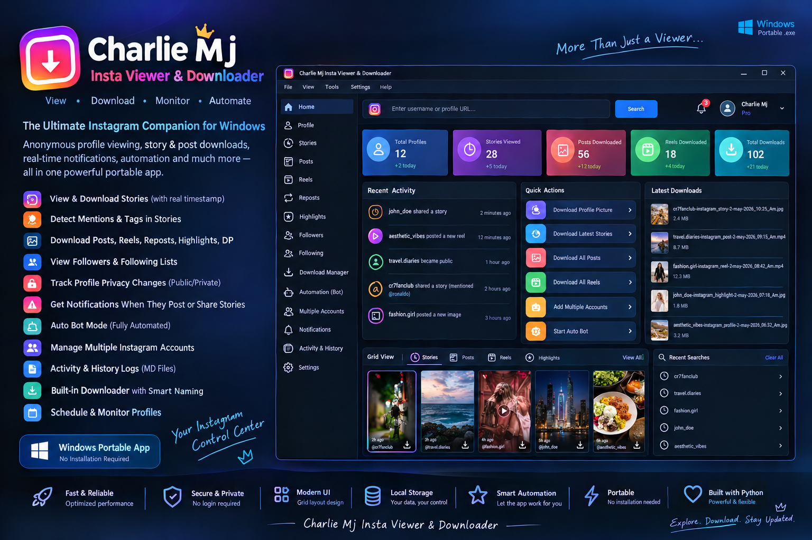

# Charlie MJ Insta Viewer & Downloader

A planned Windows desktop application for managing supported public Instagram profile information and media workflows in one place.



> **Development status:** This repository currently contains the React/Vite frontend demonstration. The Tauri desktop shell, Rust backend, SQLite persistence, live provider integrations, monitoring bot and production download engine are planned work and are not yet implemented. Mock records must not be mistaken for live Instagram data.

## Project at a glance

- **Frontend prototype:** React, TypeScript, Vite and Tailwind CSS.
- **Planned desktop framework:** Tauri 2.
- **Planned native backend:** Rust.
- **Planned local database:** SQLite.
- **Target platform:** Windows 10/11 (final supported versions to be validated).
- **Distribution goal:** Portable Windows package and optional installer.

## Planned features

- Multi-profile management and search.
- Stories, Story Inspector and Story calendar.
- Publication, detection and download timestamps kept separate.
- Mention metadata display when supplied by the connected provider.
- Highlights, Posts, carousels, Reels and supported repost records.
- Profile-picture viewing and downloads.
- Scheduled profile monitoring and visibility-state history where observable.
- New-content notifications and automatic download rules.
- Centralized download manager and local media library.
- Searchable activity timeline and daily/weekly/monthly Markdown reports.
- Backup, restore, configurable settings and local-first storage.

Feature availability depends on the connected provider. The application will not bypass private-account restrictions, authentication controls or provider rate limits, and it will not invent unavailable timestamps or mention data.

## Screenshots and artwork

The banner in `assets/` is a concept illustration for the intended design. It is not a screenshot of a completed desktop build.

## Quick start: current frontend prototype

### Requirements

- Git
- Node.js LTS
- npm

### Run locally

```powershell
git clone https://github.com/awsrmmustansarjavaid/charlie-mj-insta-viewer.git
cd charlie-mj-insta-viewer
npm install
npm run dev
```

Open the local URL printed by Vite.

### Build the web frontend

```powershell
npm run build
npm run preview
```

The output is written to `dist/`. This is a static web build, **not** a Windows EXE.

## Planned Windows desktop build

Tauri has not yet been integrated into the current prototype. After the Tauri project, Rust backend, Windows prerequisites and desktop scripts are implemented, the intended workflow will be similar to:

```powershell
npm install
npm run tauri:dev
npm run tauri:build
```

These commands are future targets and are not available in the current repository until configured. See [Windows Build Guide](docs/BUILD_WINDOWS.md).

## Repository documentation

- [Project Overview](docs/PROJECT_OVERVIEW.md) — purpose, motivation, goals and current status.
- [Architecture Design](docs/ARCHITECTURE.md) — frontend, Tauri/Rust, providers, scheduler, downloader and storage boundaries.
- [Feature Catalogue](docs/FEATURES.md) — detailed feature inventory and acceptance expectations.
- [Development Guide](docs/DEVELOPMENT.md) — prerequisites, current commands, workflow and definition of done.
- [Windows Build Guide](docs/BUILD_WINDOWS.md) — web build versus future portable desktop packaging.
- [Data Providers](docs/DATA_PROVIDERS.md) — provider interface, capability registry and metadata provenance.
- [Database Design](docs/DATABASE.md) — proposed SQLite entities, timestamps, indexes and migrations.
- [Frontend Design Guide](docs/DESIGN_GUIDE.md) — navigation, grids, Story Inspector and visual principles.
- [Code Comment Standards](docs/COMMENTING_STANDARDS.md) — required comments and file documentation conventions.
- [Security & Privacy](docs/SECURITY_PRIVACY.md) — local data, credentials, filesystem and responsible provider use.
- [Development Roadmap](docs/ROADMAP.md) — phased implementation and exit criteria.

## Code documentation policy

Every authored source file should include a useful purpose comment or module docstring where the file format supports comments. Comments must explain responsibility, important decisions and side effects—not merely repeat code.

Strict JSON formats do not support comments. Do not add comments to `package.json`, lockfiles or `.webmanifest`; document those settings in the relevant Markdown files instead. See [Code Comment Standards](docs/COMMENTING_STANDARDS.md).

## Data provider and feature limitations

Instagram API capabilities and third-party provider access vary by account type, permissions, endpoint and provider terms. The app must show capability status for each operation. Exact Story publication times, structured Story mentions, arbitrary follower/following lists, Highlights and repost records must not be promised unless the selected authorized source actually provides them.

## Existing frontend preservation

The current frontend is the starting point. New desktop functionality should be added incrementally, retaining existing routes, components, models and local demo behavior until an equivalent replacement is implemented and tested.

## Contributing / development

Before changing a feature:
1. Read the relevant documents in `docs/`.
2. Check the existing implementation and preserve its behavior.
3. Add tests for new behavior.
4. Update the feature and architecture documentation.
5. Verify the build and clearly document any unsupported capability.

## Disclaimer

Charlie MJ Insta Viewer & Downloader is an independent project and is not affiliated with, endorsed by or sponsored by Instagram or Meta. Use only data sources and workflows that you are authorized to use. Respect platform terms, creator rights and applicable laws.
