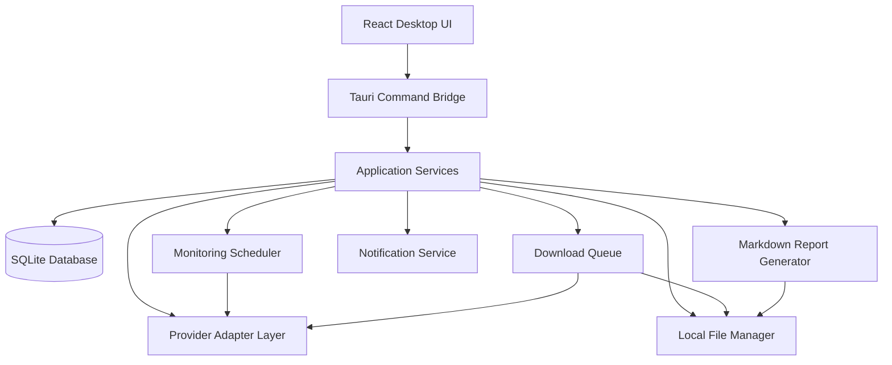

# Architecture Design

## 1. Architectural direction

The target application uses a modular desktop architecture:

- React/TypeScript renders the interface.
- Tauri exposes a controlled bridge to native desktop commands.
- Rust owns filesystem operations, scheduling, download orchestration and native integrations.
- SQLite stores profiles, media metadata, jobs, notifications and activity.
- Provider adapters normalize data from supported external sources.

The existing frontend should be migrated incrementally. Do not move all business logic into React components or bind the interface directly to a single provider.

## 2. High-level component diagram



## 3. Frontend layer

Responsibilities:

- Page routing and navigation.
- Dashboard cards and grids.
- Profile and media viewers.
- Story Inspector.
- Search and filters.
- Download queue presentation.
- Monitoring controls.
- Notification center.
- Activity and report screens.
- Settings forms.

Frontend components should call typed service functions. They should not directly access provider credentials, arbitrary filesystem paths or database connections.

## 4. Tauri/Rust desktop layer

Responsibilities:

- Validate frontend command arguments.
- Enforce filesystem path boundaries.
- Read and write application files.
- Coordinate SQLite access.
- Schedule background work.
- Manage download tasks.
- Publish progress events.
- Send native Windows notifications.
- Handle application lifecycle and graceful shutdown.

Only expose the minimum required commands to the frontend. Configure Tauri capabilities and permissions narrowly.

## 5. Provider adapter layer

Define a provider-neutral interface. A provider should advertise capabilities before a UI action is enabled.

Suggested operations:

- `lookup_profile`
- `get_profile_snapshot`
- `list_stories`
- `get_story_details`
- `list_highlights`
- `list_posts`
- `list_reels`
- `list_reposts`
- `get_media_download_source`
- `get_followers_page` (optional; often unavailable)
- `get_following_page` (optional; often unavailable)

Each operation should return normalized data plus provenance, retrieval time, pagination information and structured errors.

### Capability states

- Supported
- Partially supported
- Requires authorization
- Unavailable
- Temporarily unavailable

Do not infer support from a successful profile lookup. Each operation needs its own capability declaration.

## 6. Timestamp and mention provenance

Store separate values:

- `published_at`: source-reported original publication time; nullable.
- `first_detected_at`: local UTC time when the app first observed the item.
- `downloaded_at`: local UTC time when the file was saved.
- `source_timezone`: source-provided timezone or offset, if known.
- `timestamp_precision`: exact, approximate, date-only, or unknown.
- `metadata_source`: provider or source identifier.

Mention data should store the structured metadata source and retrieval time. OCR-derived text, if later added, must be labeled as OCR inference and must not be represented as a confirmed platform mention.

## 7. Monitoring architecture

A scheduler creates jobs from per-profile schedules. A worker claims due jobs, checks provider capability and rate limits, performs the request, normalizes the result, compares stable IDs with existing records, stores newly discovered items, and emits activity/notification events.

Recommended job states:

- pending
- running
- succeeded
- retry_wait
- failed
- cancelled

Use bounded concurrency, exponential backoff with jitter, provider-specific rate limits, and a maximum retry policy. A network failure must not be recorded as a visibility-state change.

## 8. Download architecture

The download manager should:

1. Validate the selected media record.
2. Ask the active provider for an allowed media source.
3. Validate destination and filename.
4. Create a queue record.
5. Download to a temporary file.
6. Check response and file integrity.
7. Rename atomically to the final filename.
8. Update SQLite and emit completion activity.
9. Preserve a useful error if any step fails.

Do not store expiring source URLs as permanent media identifiers. Keep provider IDs and local file paths separately.

## 9. Local storage layout

```text
Charlie-MJ-Insta-Viewer/
├── Charlie-MJ-Insta-Viewer.exe
├── data/
│   ├── database/
│   │   └── insta-viewer.db
│   ├── settings/
│   ├── cache/
│   └── thumbnails/
├── Downloads/
├── activity/
│   ├── daily/
│   ├── weekly/
│   ├── monthly/
│   └── profiles/
├── backups/
└── logs/
```

The application should support a portable data mode and a user-data-directory mode. Resolve paths through one Rust path service rather than hardcoding paths throughout the codebase.

## 10. Suggested source layout

```text
src/
├── app/
├── components/
├── pages/
├── services/
│   ├── profiles/
│   ├── stories/
│   ├── mentions/
│   ├── posts/
│   ├── reels/
│   ├── downloads/
│   ├── monitoring/
│   ├── notifications/
│   └── activity/
├── types/
├── hooks/
├── store/
└── utils/

src-tauri/
├── src/
│   ├── commands/
│   ├── database/
│   ├── providers/
│   ├── scheduler/
│   ├── downloader/
│   ├── notifications/
│   └── filesystem/
├── migrations/
├── capabilities/
└── tauri.conf.json
```

This is a target layout. Keep the existing project files until their replacements are implemented and verified.

## 11. Error handling

Use typed errors with a stable error code, user-facing message, retryability flag and diagnostic context. Never expose secrets or full credential-bearing URLs in logs.

Distinguish:
- not found
- private or inaccessible
- unauthorized
- unsupported operation
- provider rate limit
- provider outage
- network timeout
- expired media source
- local disk full
- filesystem permission error
- invalid media
- database error

## 12. Testing boundaries

- Unit-test normalizers and filename generation.
- Integration-test SQLite repositories and migrations.
- Test provider adapters using fixtures.
- Test scheduler behavior with a controllable clock.
- Test duplicate detection.
- Test download cancellation and retry.
- Test portable path resolution.
- End-to-end test the UI using mock providers.
